# Snapmaker U1 Card für Home Assistant

[English](README.md) | **Deutsch**

[](https://hacs.xyz) [](https://github.com/Ironoxx/ha-snapmaker-u1-card/releases/latest) [](https://ko-fi.com/ironoxx)

Eine Integration für den Snapmaker U1 in Home Assistant, mit eigener Dashboard-Karte. Sie spricht direkt mit dem Drucker und deckt alles ab: Live-Werte und Steuerung, Kamera, Filament und Spoolman, Benachrichtigungen, Strom und Kosten. Keine Moonraker-Integration, keine weiteren Karten, keine Add-ons.

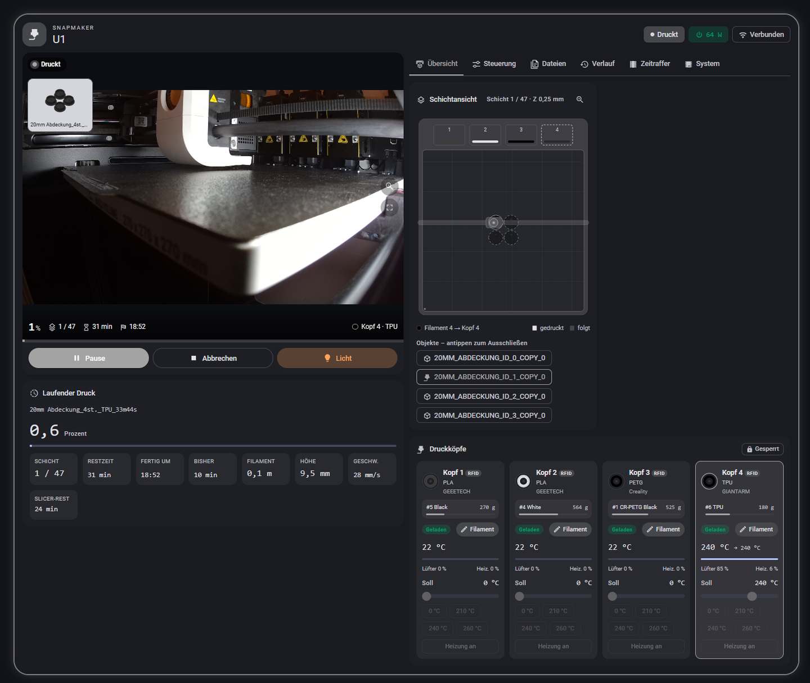

## Was sie kann

**Drucken**
- Druckstart mit Filamentzuordnung wie in Snapmaker Orca, mit Kostenschätzung, Slicer-Einstellungen der Datei und Warnung, wenn eine Spule nicht reicht
- Warteschlange, Pause bei Schicht, Nachdruck aus dem Verlauf, Objekte im Druck auslassen
- Schichtansicht in den Farben der geladenen Spulen, Restzeit am echten Druck kalibriert

**Drucker**
- Alle Werte live vom Drucker: Temperaturen, Lüfter, Licht, Achsen, MCU- und CPU-Last
- Volle Steuerung: Pause, Abbrechen, Not-Halt, Referenzfahrt, Temperaturen, Lüfter, Geschwindigkeit, Flussrate
- Temperaturverlauf für Köpfe, Bett, Innenraum, Schrittmotortreiber und CPU
- Bed-Mesh-Heatmap, G-Code-Konsole, Köpfe aufnehmen und ablegen, Top Cover und Kammerheizung

**Kamera**
- Zu Hause WebRTC, unterwegs (Nabu Casa) RTSP über Home Assistant, sonst MJPEG oder Standbilder, auch mit der Kamera der Stock-Firmware
- Zoom, Vollbild, zweite Kamera (USB), Zeitraffer-Player mit Sicherung in den Medienordner

**Filament und Spoolman**
- Material, Hersteller und Farbe je Kopf aus Firmware und RFID-Tag, für Spulen ohne Tag von Hand änderbar
- [Spoolman](https://github.com/Donkie/Spoolman): Spule je Kopf, neue Spulen direkt aus der Karte, Verbrauch je Kopf gebucht, Preise aus Spoolman, SpoolLink

**Rund um den Drucker**
- Benachrichtigungen aufs Handy mit Kamerabild und Knöpfen, laufende Fortschrittsanzeige unter Android
- Netzschalter mit sauberem Herunterfahren, Auto-Ein und Auto-Aus, Strom und Kosten je Druck
- Verlauf, Statistik je Material, Wartungsplaner, Firmware-Prüfung, Selbsttest, Sicherung der Druckerkonfiguration, Sprachbefehle über Assist
- Einstellungen direkt in der Karte; die Karte folgt deinem Theme und deiner Sprache (Deutsch oder Englisch)

Das funktioniert lokal, über VPN und über Nabu Casa gleich.

## Screenshots

| Steuerung: Bed Mesh, Flussrate, Temperaturen, Konsole | Verlauf und Statistik |
|---|---|
| 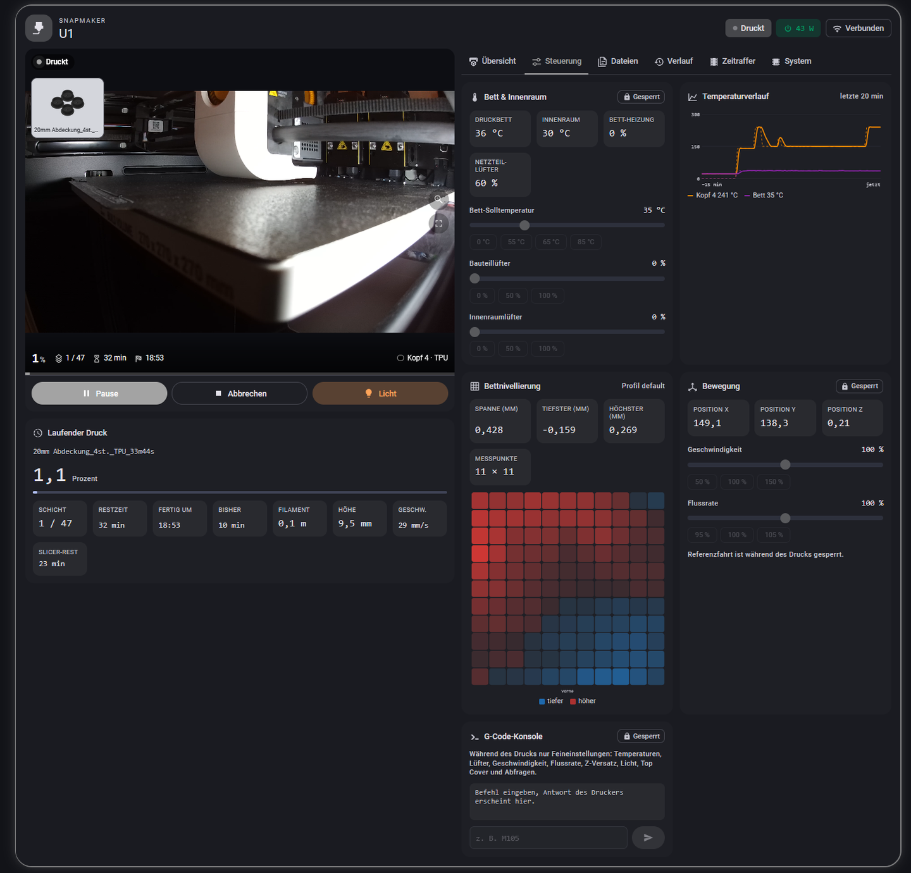 | 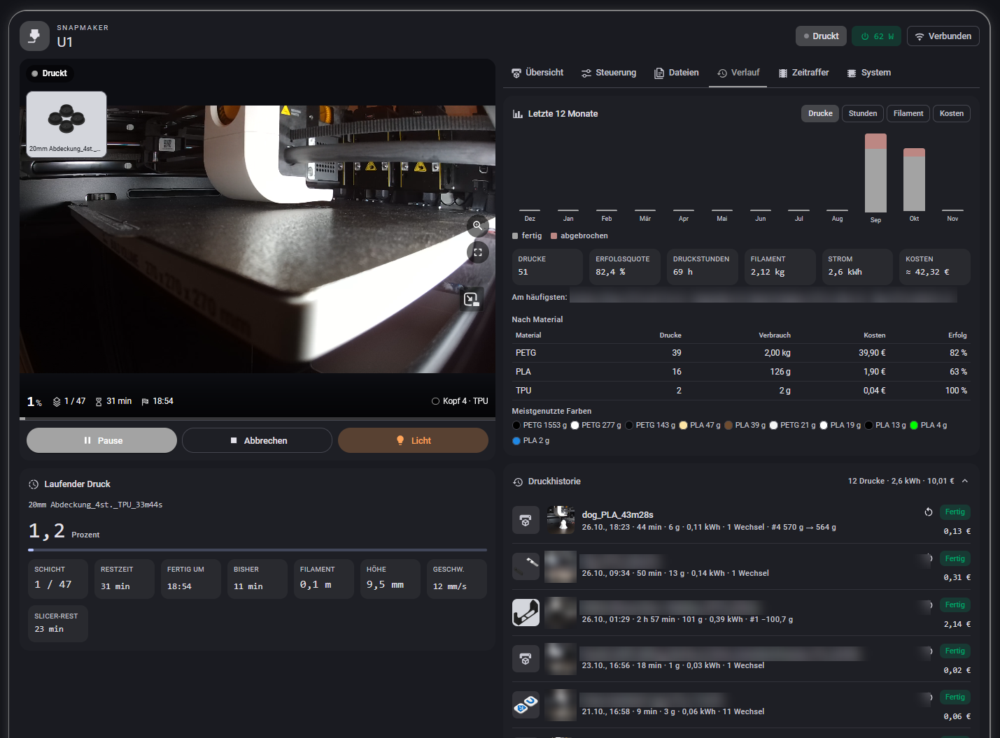 |
| **Dateien mit Vorschaubildern** | **System, Wartung und Diagnose** |
| 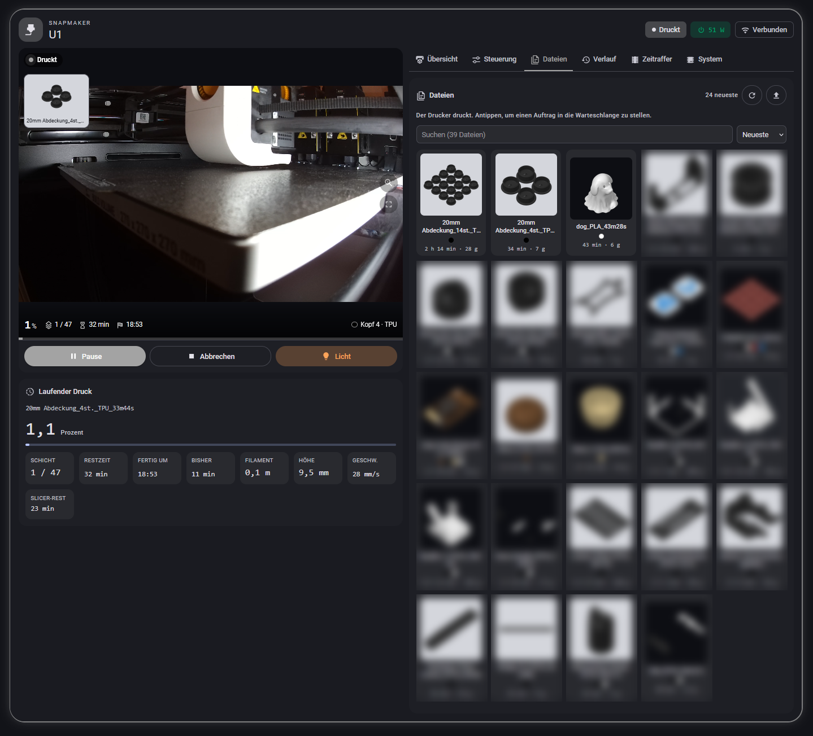 | 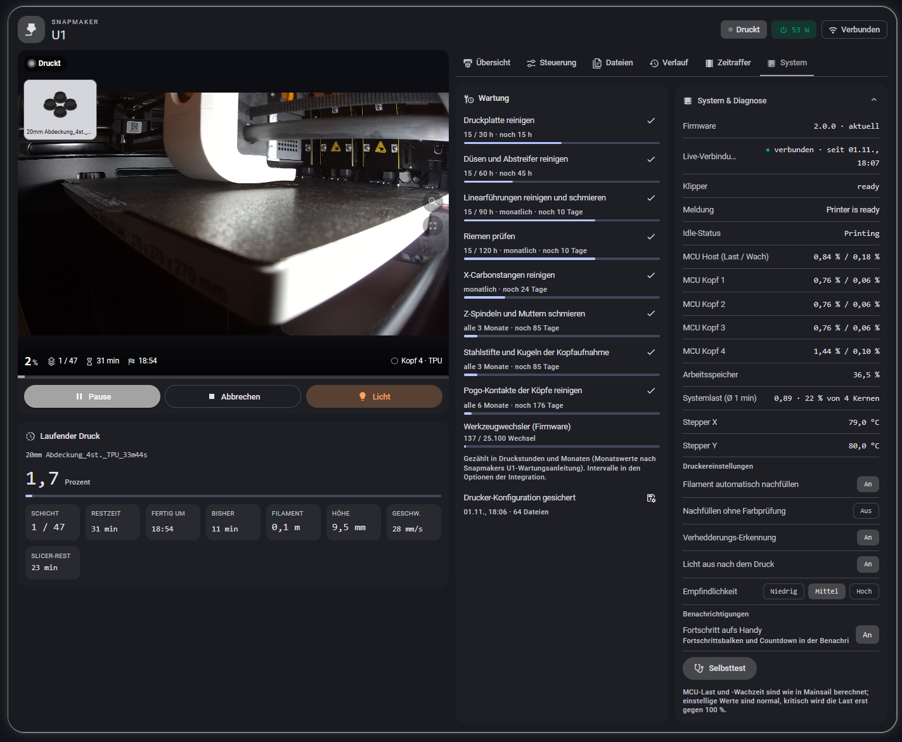 |
| **Objekt im Druck auslassen** | **Zeitraffer-Player** |
| 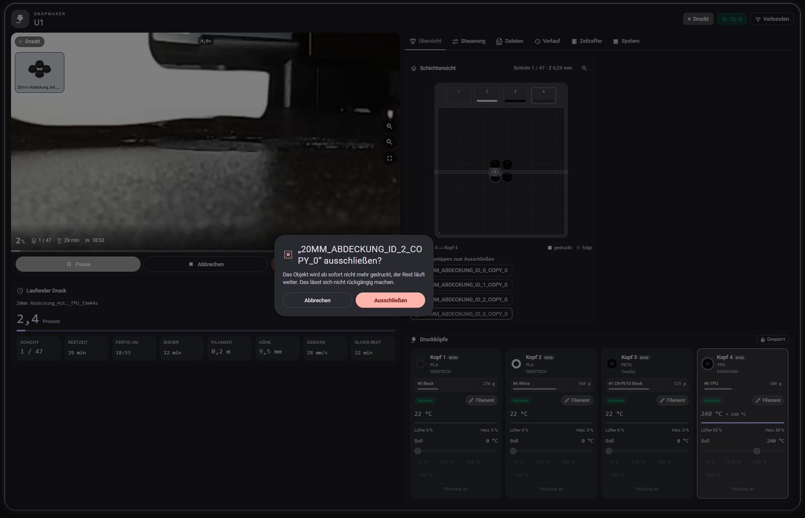 | 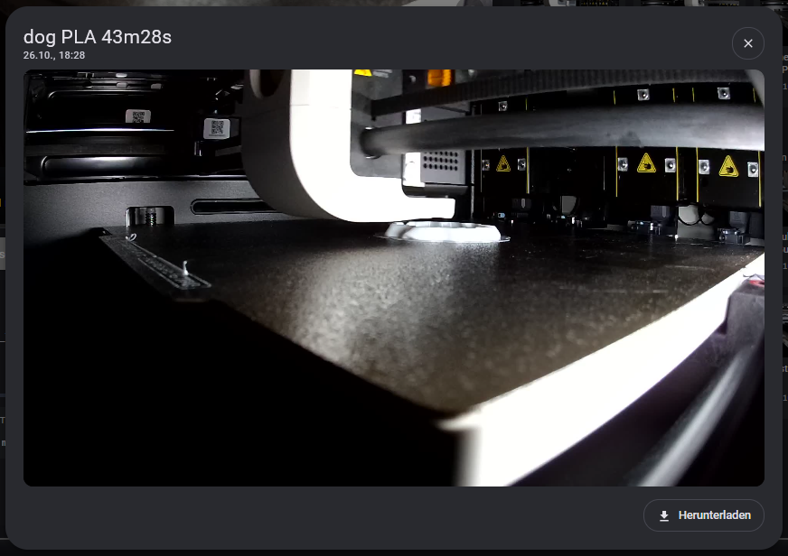 |
| **Druckstart mit Filamentzuordnung** | **Selbsttest** |
| 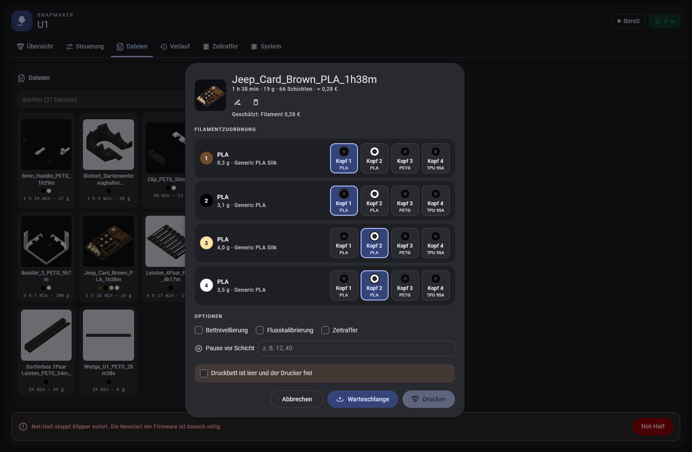 | 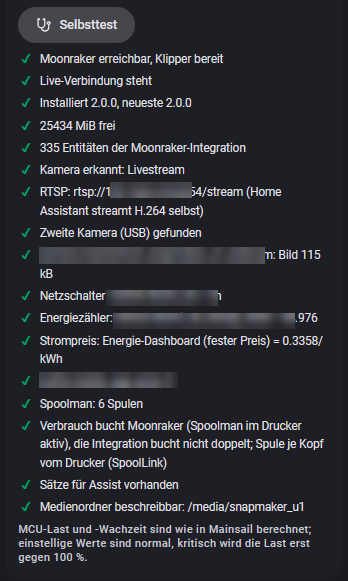 |

<details>
<summary>Einstellungen in der Karte, Benachrichtigungen, Handy</summary>

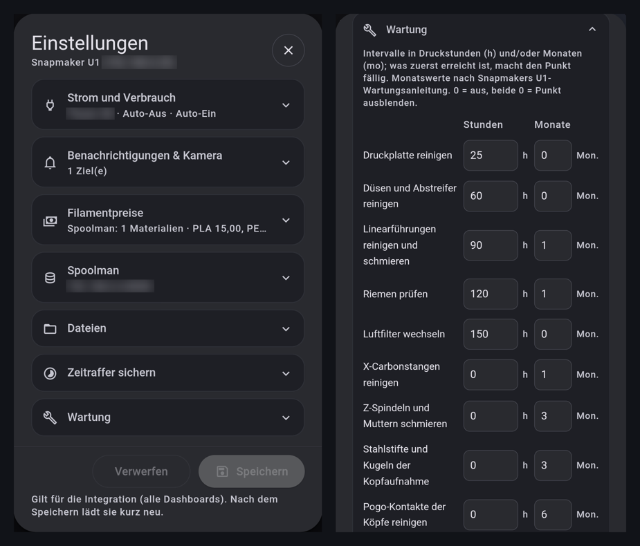

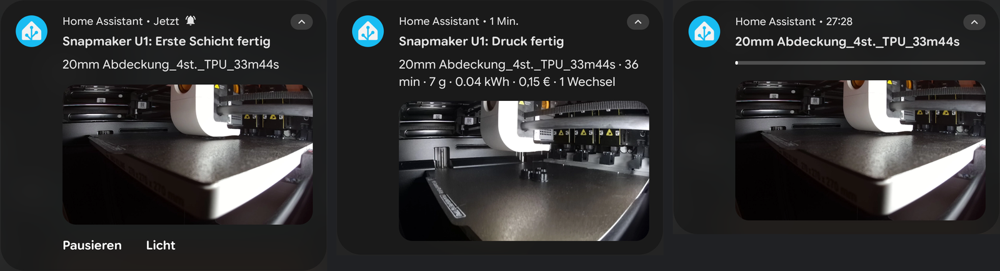

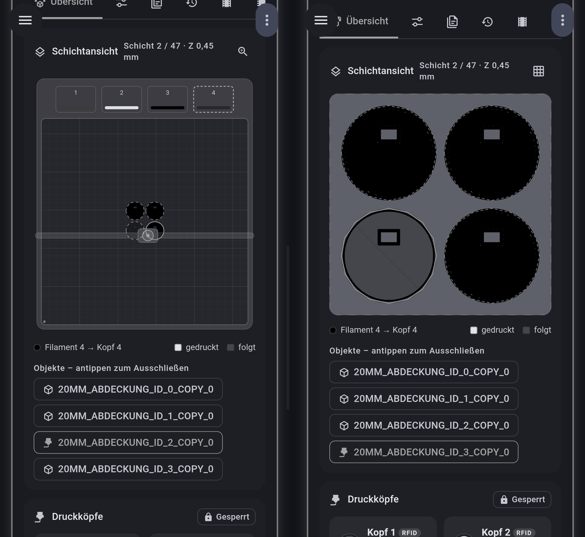

</details>

## Voraussetzungen

- Home Assistant 2025.3 oder neuer, [HACS](https://hacs.xyz) empfohlen
- Snapmaker U1 im Netzwerk mit fester IP-Adresse
- Firmware: Snapmaker-Stock, Extended Firmware (paxx12) oder Stock mit Bespok3d
- Optional: Companion-App (Benachrichtigungen), Steckdose mit Energiezähler (Netzschalter, Strom, Kosten), [Spoolman](https://github.com/Donkie/Spoolman)

Die Integration spricht mit Moonraker auf dem Drucker (Port 80); die Stock-Firmware braucht keinen API-Schlüssel.

## Installation

1. **HACS** → ⋮ → *Benutzerdefinierte Repositories* → `https://github.com/Ironoxx/ha-snapmaker-u1-card`, Typ *Integration* → **Snapmaker U1 Card** installieren → Home Assistant neu starten.
   Ohne HACS: `custom_components/snapmaker_u1_card` aus dem [neuesten Release](https://github.com/Ironoxx/ha-snapmaker-u1-card/releases/latest) nach `/config/custom_components/` kopieren und neu starten.
2. *Einstellungen → Geräte & Dienste → Integration hinzufügen → Snapmaker U1 Card*, IP-Adresse des Druckers eingeben. Im zweiten Schritt stehen alle Einstellungen; alles ist optional und später änderbar.
3. Karte ins Dashboard: *Karte hinzufügen → Snapmaker U1* (oder *Snapmaker U1 Mini*), oder in YAML:

   ```yaml
   type: custom:snapmaker-u1-card
   ```

   Am besten in einer *Panel*-Ansicht oder in *Abschnitte* mit voller Breite. Eine Ressource musst du nicht anlegen, das macht die Integration selbst.
4. Den Selbsttest in der Karte unter *System → Selbsttest* ausführen. Er prüft Drucker, Kamera, Strom-Entitäten und Benachrichtigungen.

**Update:** in HACS aktualisieren und Home Assistant neu starten. Einstellungen, Verlauf und Spulenzuordnung bleiben erhalten. Die Integration nicht löschen und neu hinzufügen, das legt einen neuen Eintrag ohne deinen Verlauf an.

**Moonraker-Integration:** seit 2.0 nicht mehr nötig. Eine vorhandene kann bleiben; die Karte greift nur darauf zurück, wenn eigene Werte fehlen. Du kannst sie auch deaktivieren oder entfernen.

## Dokumentation

- [Einstellungen](docs/de/einstellungen.md): Einstellungen der Integration, Einstellungen in der Karte, Kartenoptionen, Mini-Karte
- [Funktionen im Detail](docs/de/funktionen.md): Filamentzuordnung, Kamera, Benachrichtigungen, Restzeit, Spoolman, Strom und Kosten, Wartung und mehr
- [Entitäten und Dienste](docs/de/referenz.md): alle Entitäten, Dienste und Ereignisse für eigene Automationen
- [Fehlersuche](docs/de/fehlersuche.md)
- [Architektur](docs/ARCHITECTURE.md) und [Mitmachen](CONTRIBUTING.md) für Entwickler (Englisch)

## Rückmeldung und Unterstützung

Fehler und Ideen gern als [Issue](https://github.com/Ironoxx/ha-snapmaker-u1-card/issues), am besten mit der Diagnose-Datei (*Geräte & Dienste → Snapmaker U1 Card → ⋮ → Diagnose herunterladen*) und der Firmware-Version.

Die Integration ist kostenlos. Ein Stern auf GitHub hilft, und wer mag, spendiert einen Kaffee:

[](https://ko-fi.com/ironoxx)

## Lizenz

MIT, siehe [LICENSE](LICENSE). Ohne Gewähr, Nutzung auf eigenes Risiko. Kein offizielles Produkt von Snapmaker und nicht mit Snapmaker verbunden; „Snapmaker“ und „U1“ sind Marken ihrer Inhaber.
