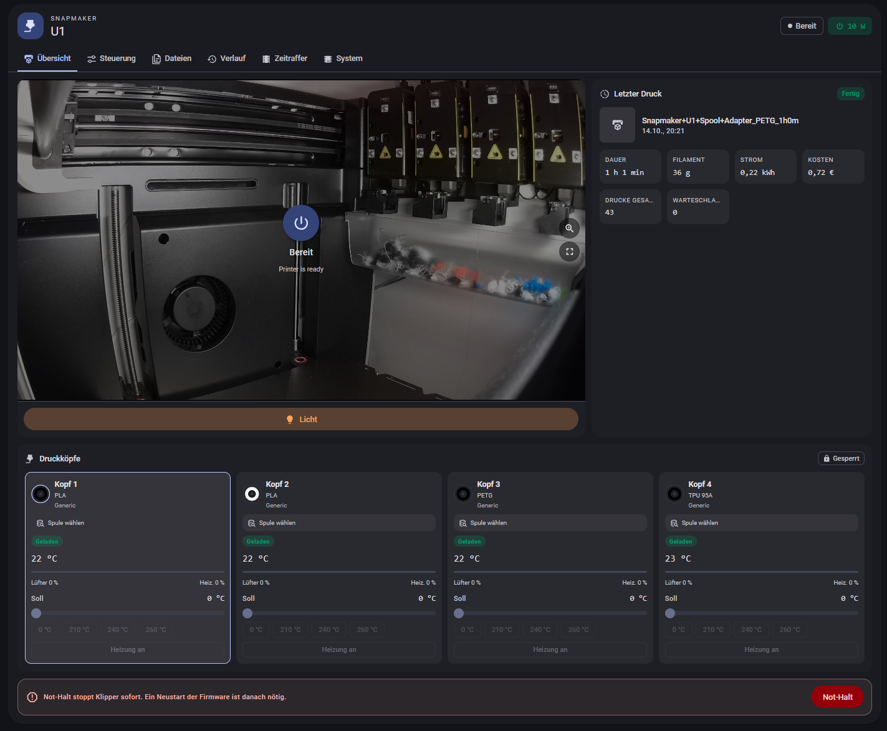
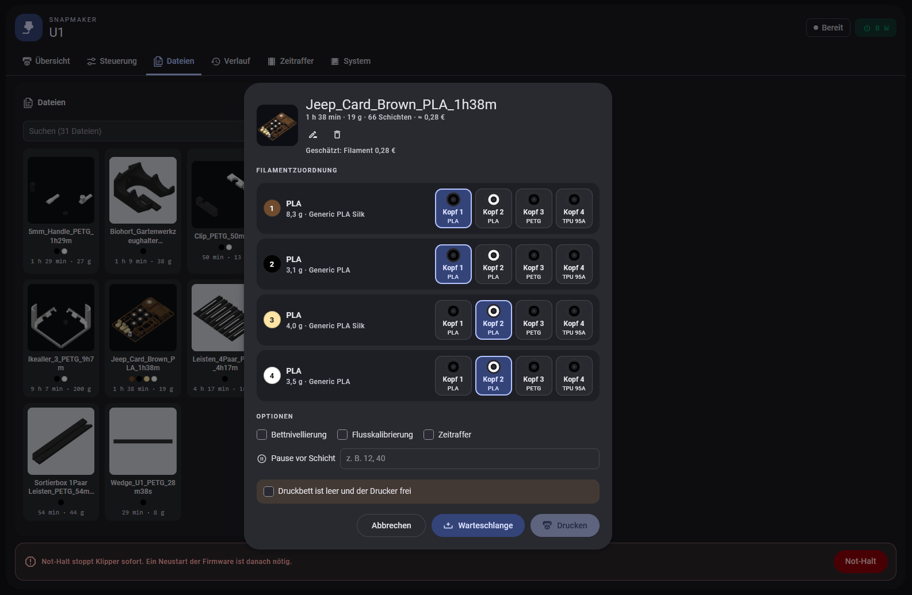
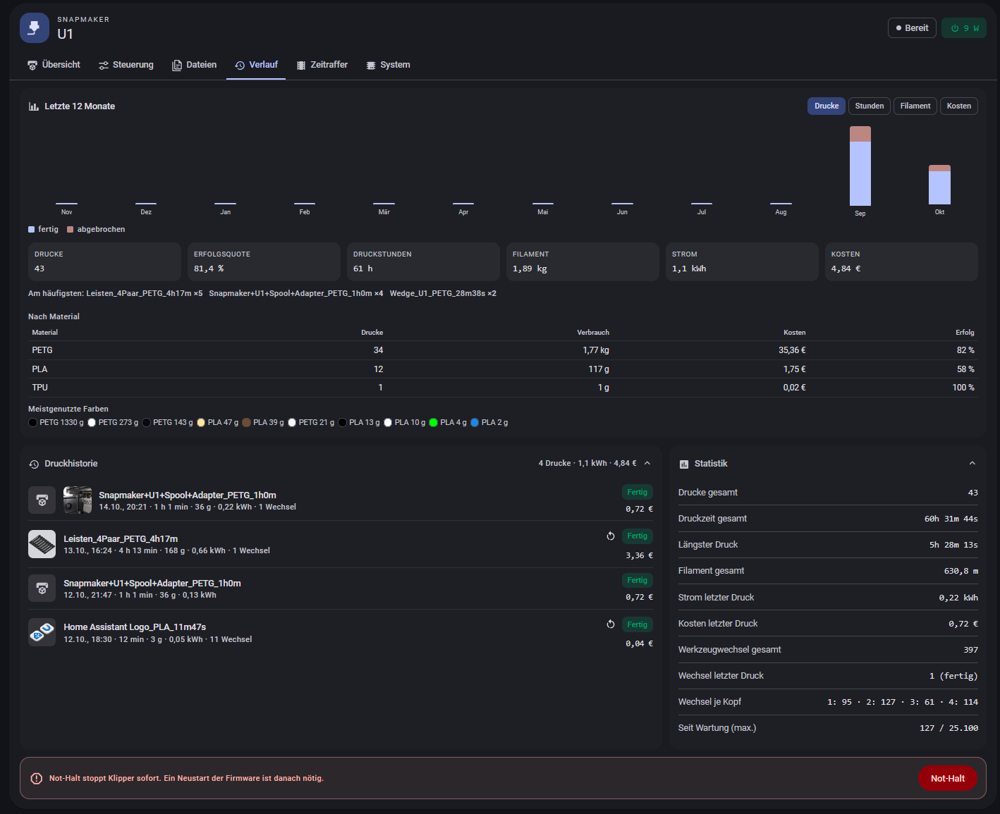
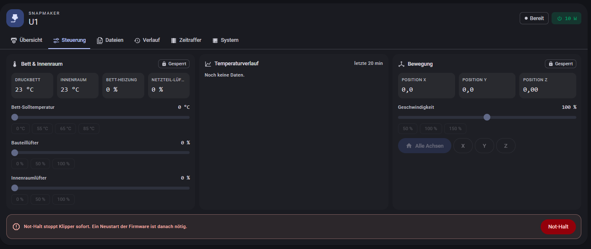
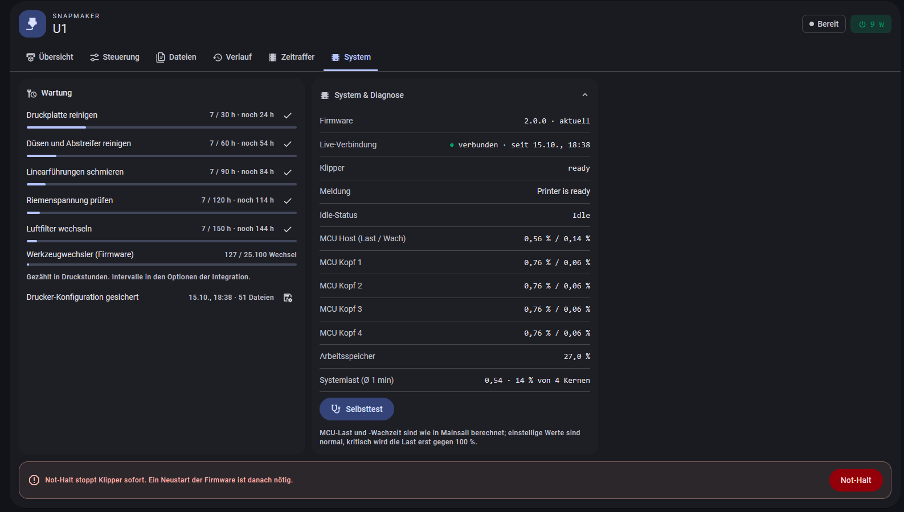
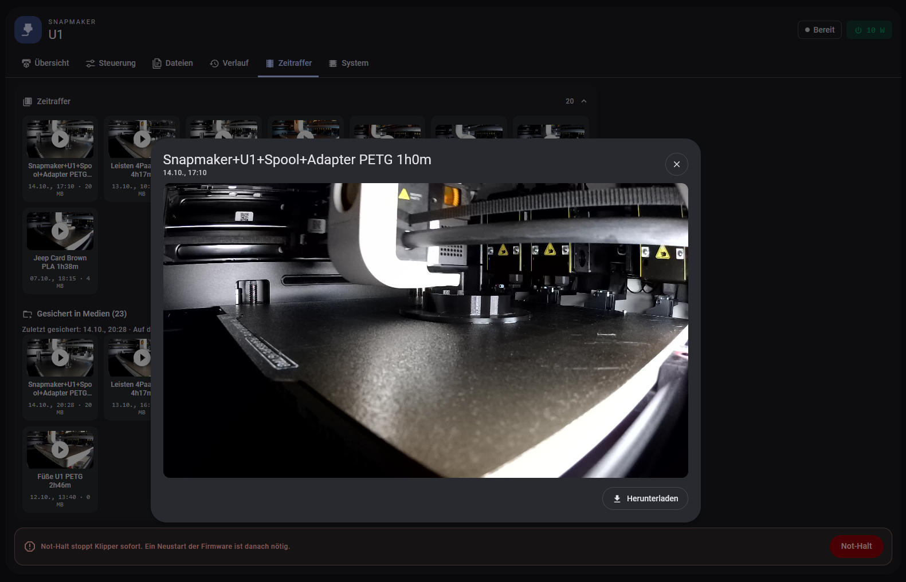

# Snapmaker U1 Card for Home Assistant

**English** | [Deutsch](README.de.md)

[](https://hacs.xyz) [](https://github.com/Ironoxx/ha-snapmaker-u1-card/releases/latest) [](https://ko-fi.com/ironoxx)

A Home Assistant integration with a built-in dashboard card for the **Snapmaker U1**:

- **Loaded filaments live**: material, sub type, vendor, colour (including multi-colour) and RFID detection per print head, straight from the printer firmware.
- **Head details**: tap **Filament** on a head (or the spool itself) to see the spool's RFID data (weight, diameter, nozzle/bed/drying temperatures, manufacturing date, SKU) and to **set material, vendor and colour by hand** for spools without a tag.
- **Print start with filament mapping like Snapmaker Orca**: tap a file and the card suggests which filament of the file goes to which head, based on material and colour. Change the mapping, choose bed leveling, flow calibration and timelapse, then start.
- **File list with thumbnails**, print time, weight and colour dots per file.
- **Camera** as a live stream through Home Assistant, with automatic fallback to still images. Zoom with two fingers, double tap, Ctrl+mouse wheel or the zoom buttons, fullscreen; when zoomed, pan with one finger or the left mouse button. During a print, progress, layer, remaining time, finish time and active head are shown on the image.
- **Layer view** below the camera: paths of the current layer in the colours of the loaded spools, printed part solid, the rest faded.
- **Tabs** instead of a long page: overview, control, files, history, timelapse, system. Icons only on phones.
- **Mini card** `snapmaker-u1-mini-card` for overview dashboards: status, progress, filaments with Spoolman remainder, power switch.
- **Visual editor** for both cards, no YAML needed.
- **Tool changes**: total, per head, in the running or last print, and progress towards the recommended maintenance.
- **Power switch**: any plug (Shelly, KNX, Zigbee …). Switching off shuts the printer down cleanly first and is blocked during a print. Optional auto-off after the print and auto-on when starting a print from the card.
- **Energy and cost per print**: consumption from an energy meter, cost with a price entity (dynamic tariffs work too), a fixed price or the price from the Home Assistant energy dashboard, filament cost from slicer weight and price per kg.
- **Print history** of the last 20 prints with result, duration, weight, kWh, tool changes and cost.
- **Live instead of polling**: Moonraker reports state changes, layer, active head and errors immediately (WebSocket subscription). Regular polling then only runs every 30 s as a consistency check.
- **Phone notifications** at print end, error or pause (e.g. filament runout), for new printer messages during a print, after the first layer, shortly before the end and when a spool will not last, with a camera image.
- **Cost before printing** in the start dialog: filament from slicer weight × price, energy from print time × average power of your previous prints × current price.
- **Voice control via Assist**: "How far is the printer?", "Pause the printer", "Resume the print".
- **Remaining time from the file's time profile**, calibrated with the real print duration; sensors *Time remaining* and *Finish time*.
- **Buttons in the notification**: pause, resume, cancel (with confirmation), light.
- **Result photo** at print end in the history, **temperature chart** of the last 20 min, **file management** with search across all files, folders, rename and delete.
- **Firmware version** as an update entity, **self test**, **statistics per material and colour**, **idle shutdown**.
- **Backup of the printer configuration** (printer.cfg & co.) daily to `/config/snapmaker_u1_backup/`, only when something changed.
- **Diagnostics download** under *Devices & services* for troubleshooting (credentials redacted), and the diagnostic entity **Live connection**, also in the card under *System*.
- **Timelapses** from the printer: play and download in the card, optionally back them up to the Home Assistant media folder.
- **Upload files** from the card (also via Nabu Casa), followed directly by the print dialog.
- **Queue** with mapping and options per job. Never starts on its own: clear the bed after a print, then tap.
- **Pause at layer** (e.g. for magnets or nuts) and **reprint from the history** with the original mapping.
- **Printer messages in plain language** instead of firmware codes, with a hint on what to do.
- **Charts** of the last 12 months (prints, hours, filament, cost) from Moonraker's print history, so retroactive too.
- **Maintenance planner** in print hours (build plate, nozzles, rails, belts, filter) plus the firmware's tool changer counter.
- **Spool management with [Spoolman](https://github.com/Donkie/Spoolman)** (optional): spool per head with remaining weight, automatic assignment, a warning when a spool is not enough for the print, and usage booked per head after the print.
- **Printer settings** as switches and in the card: auto-replenish filament, replenish ignoring colour, filament entangle detection (with sensitivity), light off after print. Stored on the printer, changeable during a print.
- **Keep the camera awake** (optional): for stock firmware whose camera image stops after a while.
- **State accent**: a thin frame in the colour of the state (printing, paused, error, done).
- Temperatures, targets, fans, light, axes, diagnostics and statistics.

Everything runs through the Home Assistant connection. It works the same locally, over VPN and through Nabu Casa, without CORS or mixed-content problems.

**The design follows your Home Assistant theme**: colours, light/dark mode, fonts and corner radii come from the active theme (Material You tokens where available), so the card blends into any dashboard.

> Language: card and integration follow the Home Assistant language (German, otherwise English).

> **Testers wanted!** The integration is in daily use but still young and has only been tried on a few printers. If you own a Snapmaker U1 and want to help: install it and report experiences, bugs or ideas as an [issue](https://github.com/Ironoxx/ha-snapmaker-u1-card/issues), ideally with the diagnostics file (*Devices & services → Snapmaker U1 Card → ⋮ → Download diagnostics*), the firmware version and, for print problems, the G-code file. Testing and use are voluntary, without warranty and at your own risk.

> Not an official Snapmaker product and not affiliated with Snapmaker. "Snapmaker" and "U1" are trademarks of their owners and are only used to name the supported printer. Use at your own risk.

## Screenshots

The screenshots show the German UI; with Home Assistant set to English the card is in English.



| Print start with filament mapping | History and statistics |
|---|---|
|  |  |
| **Control** | **System, maintenance and diagnostics** |
|  |  |
| **Timelapse** | |
|  | |

## Requirements

| What | For | Required |
|---|---|---|
| Home Assistant 2025.3 or newer | | yes |
| [HACS](https://hacs.xyz) | installation and updates | recommended |
| [Moonraker integration](https://github.com/marcolivierarsenault/moonraker-home-assistant) | temperatures, fans, light, axes, layer, camera and system values in the card | yes |
| Snapmaker U1 on the network with a fixed IP address (DHCP reservation in the router) | connection | yes |
| Printer firmware: Snapmaker stock, Extended Firmware (paxx12) or stock with Bespok3d | | yes |
| Home Assistant Companion app | push notifications with image and buttons | optional |
| Plug/switch in HA (Shelly, Zigbee, KNX …), energy meter, energy price sensor | power switch, auto-on/-off, energy and cost | optional |
| [Spoolman](https://github.com/Donkie/Spoolman) | spool management | optional |

Both integrations talk directly to Moonraker on the printer (port 80). The stock firmware needs no API key for that.

## Installation

### 1. Moonraker integration

1. HACS → *Integrations* → search for **Moonraker** → install → restart Home Assistant.
2. *Settings → Devices & services → Add integration → "Moonraker"*.
3. **Host:** IP address of the printer (e.g. `192.168.1.50`), **Port:** `80`, leave the API key empty.
4. Check: the new device shows sensors such as `sensor.<name>_printer_state` and a camera.

The card finds the Moonraker entities by itself, even with a different device name. Only with several printers do you need to set the `prefix` in the card.

### 2. Snapmaker U1 Card

1. **HACS** → ⋮ → *Custom repositories* → `https://github.com/Ironoxx/ha-snapmaker-u1-card`, type *Integration* → add → install **Snapmaker U1 Card** → restart Home Assistant.
   *Without HACS:* unpack `snapmaker_u1_card-<version>-install.zip` from the [latest release](https://github.com/Ironoxx/ha-snapmaker-u1-card/releases/latest), copy the folder `custom_components/snapmaker_u1_card` to `/config/custom_components/`, restart.
2. *Settings → Devices & services → Add integration → "Snapmaker U1 Card"* → printer IP address, port `80`.
3. Fill in the settings in the second step (all optional, can be changed later under *Configure*, see [settings](#integration-settings)).
4. **Self test:** in the card under *System → Self test* (or the service `snapmaker_u1_card.self_test`). It shows whether printer, Moonraker integration, camera, power entities and notifications are set up correctly.

### 3. Add the card to a dashboard

Edit the dashboard → *Add card* → choose **Snapmaker U1** (or **Snapmaker U1 Mini**). Everything else is in the visual editor. In YAML:

```yaml
type: custom:snapmaker-u1-card
```

Works best in a *Panel* view or a *Sections* view at full width; on phones the card adapts.

Done. You do **not** need to add a resource yourself; the integration loads the card on two paths:

1. Through the Home Assistant start page (`add_extra_js_url`).
2. As the dashboard resource `/local/snapmaker_u1_card/snapmaker-u1-card.js?v=…`. The integration creates it, keeps it current on updates and removes it together with the integration. Please leave it under *Dashboards → Resources*.

The second path is needed because Home Assistant serves pages before custom integrations have started. Anyone loading in that window (tab or app during a restart) would otherwise get "Custom element doesn't exist: snapmaker-u1-card" until they reload. If `/config/www` did not exist before, the second path only takes effect after another restart.

## Updating

Replace the folder `custom_components/snapmaker_u1_card` (or update in HACS) and restart Home Assistant. Settings, history, queue, maintenance, spool assignment and backed-up timelapses are kept:

| What | Where |
|---|---|
| Settings | config entry (`.storage/core.config_entries`) |
| History, queue, maintenance, Spoolman assignment, pending bookings | `.storage/snapmaker_u1_card.<entry>.print_switches` |
| Thumbnails, layer view (cache, rebuilt automatically) | `.storage/snapmaker_u1_card/` |
| Printer configuration backups | `snapmaker_u1_backup/` |
| Assist sentences (updated on every start) | `custom_sentences/de/…` and `custom_sentences/en/…` |
| Backed-up timelapses | `<media>/snapmaker_u1/` |

Do not delete and re-add the integration: that creates a new entry, and settings and history stay with the old one.

## Integration settings

During setup a second step with all settings follows right after the address. Later they are under *Devices & services → Snapmaker U1 Card → Configure*. All fields are optional; the card picks them up automatically.

| Section | Fields |
|---|---|
| Power and consumption | power switch, power sensor (W), energy meter (kWh), energy price: price entity (EUR/kWh or ct/kWh, dynamic tariffs) **or** a fixed price per kWh; if both are empty, the price from the Home Assistant **energy dashboard** is used, shut down before switching off, auto-on at print start, auto-off after the print (temperature, delay), switch off after idle (hours) |
| Notifications & camera | `notify.mobile_app_…` services, events (finished, cancelled, error, paused, message during print, first layer done, almost done, not enough filament), "almost done" lead time in minutes (10), "part removable" below bed temperature (35 °C), camera for image and result photo, **keep camera awake** (off / during a print / always) |
| Filament prices | price per kg for PLA, PETG, ABS, ASA, TPU, PA and others. `PLA-CF` uses the PLA price |
| Timelapse backup | on/off, how many of the newest stay on the printer (0 = never delete), how many stay in the media folder (50, 0 = all), delete backups older than x days (0 = never) |
| Maintenance | interval per item in print hours (0 = hide) |
| Spoolman | address (empty = off), book usage per head (on/off), warning threshold in g |
| Files | number of newest files, back up printer configuration (on) |

## Card options

All options are optional; except head names and presets they can also be set in the visual editor.

| Option | Default | Meaning |
|---|---|---|
| `layout` | `tabs` | `tabs` = tabs, `scroll` = all sections stacked, `tablet` = camera and job always visible on the left, tabs on the right (tablets, wall monitors; stacks below about 900 px) |
| `layer_view` | `part` | layer view: `part` = zoomed to the part, `bed` = top view of the whole plate with the parked heads and a nozzle marker. Also switchable in the layer view (grid button, remembered per browser) |
| `emergency_stop` | `show` | `show` = button with confirmation, `hold` = hold for 1 s (no dialog), `hide` = no button in the card (the HA button entity stays) |
| `camera_direct` | `auto` | `auto` = stream straight from the printer (`camera_direct_url`, default `http://<printer>/webcam/?action=stream`): less delay, no load on HA. Not used on https pages (the browser blocks http streams there); if no frame arrives within 4 s (e.g. away from home) the card uses the HA proxy for 10 min. `off` = always through HA |
| `camera_direct_url` | – | own URL for the direct stream |
| `camera_wake` | `true` | while the card is visible and the image stops (no stream, frozen frame), it asks the integration to send `camera.start_monitor` once (at most every 10 s) |
| `camera_overlay` | `true` | progress on the camera image; the printer state is always shown in the top-left corner (`hide_overlay: true` also turns it off) |
| `state_accent` | `true` | frame in the theme colour of the state (printing, paused, error, done) |
| `camera_height` | automatic | height of the camera image in px. Empty = image aspect ratio, at most `camera_max_height` |
| `camera_max_height` | `520` | upper limit for the automatic height in px |
| `camera_mode` | `stream` | `stream` = live image, `still` = still images (saves WiFi) |
| `refresh` | `2` | seconds between still images (`still` and fallback) |
| `camera_fit` | `contain` | `contain`, `cover`, `fill` |
| `show` | all | sections: `stage layer job queue files toolheads climate motion system maintenance charts stats history timelapse` |
| `hide` | – | sections to hide (counterpart of `show`, used by the editor) |
| `controls_lock` | `60` | lock for temperature and fan sliders, presets, heater switches and homing: `off`, seconds (`30`, `60`, `120`, `300`) until it locks again after the last interaction, or `manual` (open until locked again). During a print the card asks before changing a target temperature. Legacy: `unlock_controls: true` = `off` |
| `timelapse_limit` | `8` | timelapses shown |
| `files_limit` | `12` | files shown |
| `nozzle_presets` / `bed_presets` | `[0,210,240,260]` / `[0,55,65,85]` | quick temperature presets |
| `toolheads` | – | head names, e.g. `- name: Left` (material and colour come from the printer) |
| `network_tracker` | – | `device_tracker` for a WiFi chip in the header |
| `prefix`, `camera`, `thumbnail`, `filaments_sensor`, `files_sensor` | automatic | only needed with several printers |

### Mini card

```yaml
type: custom:snapmaker-u1-mini-card
navigation_path: /dashboard-printer/0   # optional: go there on tap, otherwise the status dialog
```

| Option | Default | Meaning |
|---|---|---|
| `printer_name` | `U1` | display name |
| `navigation_path` | – | target on tap |
| `hide_filaments` | `false` | hide the filament row |
| `prefix` | automatic | only with several printers |

## Entities

Entity IDs follow the Home Assistant language at setup time; the English names are:

| Entity | Content |
|---|---|
| `sensor.…_filaments` | number of loaded slots, attribute `slots` with all four heads, `preferences` |
| `sensor.…_slot_1` … `_slot_4` | material of the slot or empty, colour and vendor as attributes, handy for automations |
| `sensor.…_print_files` | newest print files with filaments and thumbnail |
| `sensor.…_tool_changes` | total head changes (firmware counter), attribute `heads` per head with `switches`, `retries`, `errors`, `since_maintenance` |
| `sensor.…_tool_changes_print` | changes in the running print, otherwise the last one; attributes `in_progress`, `file`, `result`, `started`, `ended` |
| `switch.…_power` | safe power switch (only with a configured switch). **Automations should switch this one, not the plug directly.** |
| `sensor.…_energy_print` | kWh of the running or last print (only with an energy meter) |
| `sensor.…_cost_print` | energy cost so far or total cost of the last print; attributes `energy_cost`, `filament_cost` |
| `sensor.…_print_history` | count, attribute `prints` with the last 20 prints |
| `sensor.…_timelapses` | count, attribute `videos`; with backup also `archive` (backed-up videos, status) |
| `sensor.…_queue` | number of jobs, attribute `jobs` (id, file, mapping, options, pauses) |
| `sensor.…_print_hours` | total print hours (Moonraker), attributes `months`, `totals`, `top_files` |
| `sensor.…_maintenance_due` | number of maintenance items due, attribute `items` |
| `sensor.…_printer_messages` | number of open firmware messages, attribute `errors` with text (de/en), hint and raw code |
| `sensor.…_time_remaining` / `sensor.…_finish_time` | remaining time and expected end of the running print |
| `binary_sensor.…_live_connection` | live subscription to Moonraker up or not |
| `update.…_firmware` | installed and latest firmware |
| `switch.…_auto_replenish_filament`, `…_replenish_ignoring_colour`, `…_filament_entangle_detection`, `…_light_off_after_print` | firmware preferences (stored on the printer) |
| `select.…_entangle_detection_sensitivity` | `low`, `medium`, `high` |

The event `snapmaker_u1_card_print_finished` fires at every print end with `file`, `name`, `result`, `duration_s`, `tool_changes`, `energy_kwh`, `energy_cost`, `filament_g`, `filament_cost`, `total_cost`, for your own automations.

## Services

### `snapmaker_u1_card.start_print`

```yaml
action: snapmaker_u1_card.start_print
data:
  filename: Benchy_PLA.gcode
  mapping: {"0": 2, "1": 0}   # filament 1 → head 3, filament 2 → head 1; omit = automatic
  bed_leveling: true
  flow_calibration: false
  timelapse: false
```

Without `mapping` the service uses the same suggestion as the card. With `pause_layers: [12, 40]` the printer pauses before these layers.

**How "pause at layer" works.** Neither Klipper nor the U1 firmware has a command for it. The integration therefore creates a copy of the file (`<name>.u1pause-12-40.gcode`), writes `PAUSE` before the layer change (`;LAYER_CHANGE` from Orca/Snapmaker Orca, Cura markers too) and prints the copy. The firmware handles `PAUSE` in files explicitly. The copy is hidden in the file list and deleted after the print; the history shows the original file. Resume on the display or with the button in the card.

### Queue

```yaml
action: snapmaker_u1_card.queue_add      # same fields as start_print
data: {filename: Holder.gcode, mapping: {"0": 1}, pause_layers: [8]}
action: snapmaker_u1_card.queue_start    # start the first job (or job_id)
action: snapmaker_u1_card.queue_move     # job_id, position (0 = front)
action: snapmaker_u1_card.queue_remove   # job_id
action: snapmaker_u1_card.queue_clear
```

Moonraker's own queue (`[job_queue]`) is not loaded on the U1 and knows nothing about filament mapping, so the integration keeps its own list. It survives restarts. After a print a "Next job waiting" notification is sent (to the configured services).

### `snapmaker_u1_card.maintenance_done` / `backup_timelapses` / `backup_config`

`item: plate | nozzle | rails | belts | filter` resets the maintenance counter. `backup_timelapses` backs up right away and then cleans up the printer. `backup_config` backs up the printer configuration right away and responds with `status` (`saved`, `unchanged`, `empty`), the number of files, skipped files and the existing snapshots.

### `snapmaker_u1_card.set_filament` / `set_preference`

```yaml
action: snapmaker_u1_card.set_filament   # spool without RFID tag; not during a print
data:
  slot: 2            # head 1–4
  type: PETG
  sub_type: HF       # optional
  vendor: Generic    # optional
  color: "#1B5E20"   # optional
  force: false       # true = also overwrite an official Snapmaker spool

action: snapmaker_u1_card.set_preference
data:
  preference: auto_replenish   # replenish_ignore_color | entangle_detect | end_led_off | entangle_sensitivity
  value: true                  # entangle_sensitivity: low | medium | high
```

Both go to the firmware (`SET_PRINT_FILAMENT_CONFIG`, `SET_PRINT_PREFERENCES` from u1-klipper `print_task_config.py`). The printer stores the values itself, the display shows them too.

### `snapmaker_u1_card.refresh`

Reloads file list, timelapses and filaments right away.

### `snapmaker_u1_card.power_on` / `power_off`

Switch on (optionally `wait: true`: only return once Klipper is ready) or switch off safely: shut down (`machine.shutdown`), wait until the printer stops answering plus 10 s, then cut the power.

Switching off is refused or aborted when

- a print is running or paused, even if the printer briefly does not answer (a WiFi dropout does not count as "finished"),
- the printer reports right before the shutdown or before cutting power that it is printing or a heater has a target (e.g. a print started on the display),
- the printer is booting via auto-on.

For a crashed printer that is still recorded as printing: `force: true` (the card only offers this when the printer does not answer). While shutting down, `start_print` accepts no prints.

## How the filament mapping works

The integration starts prints exactly like Snapmaker Orca in LAN mode, via the Moonraker call `server.files.start_local_print` with `options.map_table`. The printer turns that into `SDCARD_PRINT_FILE_WITH_PARAMETERS … MAP_TABLE="[[0, 2], [1, 0]]"`. The firmware checks as usual whether the printer is free and the nozzles fit.

This is documented in Snapmaker's open source code:
[u1-klipper](https://github.com/Snapmaker/u1-klipper) (`klippy/extras/print_task_config.py`) and
[u1-moonraker](https://github.com/Snapmaker/u1-moonraker) (`components/snapmakercloud.py`, `components/klippy_apis.py`).

The suggestion picks a loaded head for each filament of the file in this order: same material, closest colour, still free. An empty head blocks the start. A different material only shows a warning.

## Tool changes

The firmware permanently counts every successful head change per head (`switch_count` in `extruder` … `extruder3`, source: `ExtruderSwitchRecorder` in u1-klipper `klippy/kinematics/extruder.py`). With older firmware without these fields both sensors are *unavailable* and the card hides the rows.

The firmware has no per-print counter. The integration remembers the counter at print start and takes the difference at the end. This baseline is stored and survives a Home Assistant restart during the print. Every change during the print counts, including pickups for calibrations at the start. If Home Assistant is down for a whole print, that print is missing.

The maintenance threshold is the firmware default of 25,100 changes per head. From 90 % the card shows the value in yellow. Reset after maintenance: `RESET_EXTRUDER_MAINTENANCE_COUNT` in the console.

## Energy, cost and history

- **Consumption per print** is the difference of the energy meter between start and end of the print.
- **Energy cost** is accumulated continuously (consumption since the last poll × price at that moment), so dynamic tariffs are handled correctly.
- **Filament cost**: weight per material from the file's slicer data × price per kg. For cancelled prints the weight is reduced by the ratio of extruded to planned filament. If a price is missing for a material used, the filament cost is left out instead of showing a wrong total.
- **Total cost in the history** (tile and chart): prints recorded by the integration with their real cost (filament + energy). Older prints from Moonraker, i.e. before installation, are estimated from the filament price; the tile then shows "≈". This way the total matches the material table. *Energy* only counts measured prints.
- **Auto-off** only triggers after *complete* or *cancelled*, never after an error, and only once all nozzles and the bed are below the configured temperature.
- While the printer is off, the card shows power on, files (with auto-on), history and timelapses. The filament mapping then uses the state before switching off.

**Thumbnails** get a background that fits the brightness of the part: dark parts (black filament) a light one, very light parts a dark one. The card measures the average brightness of the opaque pixels; images without transparency stay unchanged.

**Cost before printing.** The start dialog shows "≈ €0.48" with the breakdown below. Filament: weight per material from the slicer data × price per kg (left out if a price is missing). Energy: estimated print time × average power of all previous prints of 10 min and more (energy ÷ duration from the history) × current energy price. Before the first measured print only the filament part is shown.

## Live connection and notifications

The integration subscribes to `print_stats`, `toolhead.extruder`, `virtual_sdcard` and `exception_manager` in Moonraker (`printer.objects.subscribe`). Moonraker only sends changes, at most every 250 ms. State changes and new messages trigger an immediate poll, a head change updates the card directly, and the layer view takes its file position from the subscription instead of asking the printer. While the subscription is up, the integration polls only every 30 s (otherwise every 10 s). If the connection drops it reconnects with 5–60 s backoff; not at all while the printer is off.

| Event | When |
|---|---|
| Printer message | new firmware message during a print. If the printer pauses because of it, only the pause notification (with the text) is sent |
| First layer done | change from layer 1 to 2. Joining in the middle of a print (HA restart) does not send one |
| Almost done | remaining time (see below) below the configured minutes, once per print |
| Not enough filament | at print start, when according to Spoolman a spool has less left than the file needs on that head |
| Spool about to run out | during the print, when a spool will be empty in less than 30 min according to the time profile. With a hint whether the firmware will continue via **auto-replenish** from a head with the same material (and colour, unless "ignore colour" is on at the printer) or pause |
| Part ready to remove | after a finished print, once the bed has cooled below the configured temperature (35 °C) |

**Buttons in the notification** (Companion app): *Pause* and *Light* for messages during a print, *Resume* and *Cancel …* when paused. Cancel asks again with a second notification ("Yes, cancel"), so an accidental tap cancels nothing. The buttons only act while the state fits (pause only while printing, etc.).

**Remaining time.** At print start the integration downloads the file once. Slicers like Orca write their own remaining time into the file (`M73 R<minutes>`); the integration reads it per file position, so acceleration and tool changes are already included. It scales this slicer time by the measured speed, measured from the start of the first layer (the start sequence with leveling and calibration does not distort it). Until enough is printed, the speed factor and the start duration learned from earlier prints carry the estimate. During the start sequence: expected remaining start time + slicer time of the print. Files without `M73`: a time profile from the moves (distance ÷ feed rate), weighted between slicer total and measured speed. Result: the sensors *Time remaining* and *Finish time*; the card, "almost done", Assist and the progress notification use them. History entries record `prep_s` (start duration) and `speed_factor` (actual ÷ slicer time).

**Progress notification (Android).** Switch *Progress notification (Android)* (also in the card's system tab, off by default). Android phones among the notification targets get an ongoing notification with a progress bar and a countdown to the expected end. The countdown runs on the phone, so the remaining time costs no pushes. Updates only on a 10 % step, when the expected end moves by more than max(5 min, 10 %), and on pause/resume; at most one every 3 min and 25 per print, plus a daily budget per phone (option, default 150; the companion app allows about 500 pushes per day through the cloud relay). The notification starts after the start sequence, uses a silent channel (`alert_once`, low importance) and is removed at the end. End, error and pause notifications are not affected by the budget. Switch attributes: `sent_today`, `budget`, `targets`.

**Result photo. With a camera configured, the integration takes the image at the end of the print once the head has left the part: after the last extrusion it reads the head position (`motion_report`) for up to 15 s and shoots as soon as the head is 25 mm outside the parts' outline (`EXCLUDE_OBJECT_DEFINE`) or the bed has already dropped by 15 mm. The chamber light is switched on for the photo and back off afterwards if it was off. Without position or outline: 2 s after the last extrusion; without a time profile: in the last layer from 99.5 %. On cancel or error the image is taken at that moment. It is stored under `.storage/snapmaker_u1_card/thumbs/<entry>/results/` and appears in the history next to the thumbnail; tapping enlarges it in the card (tap or Esc closes). Photos are kept for the prints in the history.

## File management

Above the file list: search (across **all** files on the printer, not only the newest), sorting (newest, name, print time) and folder chips. Older matches appear as a list; tapping loads metadata and thumbnail and opens the print dialog. In the print dialog: *Download* (the G-code through Home Assistant, also works remotely), *Rename / move* (subfolders with `/` are created) and *Delete*. Both are blocked while the file is printing or queued. Services: `file_details`, `move_file`, `delete_file`.

## Temperature chart

In the *Control* tab: actual and target temperature of the active heads and the bed over the last 20 minutes. Moonraker stores this data anyway (`/server/temperature_store`); the card fetches it every 10 s through the integration, only while the tab is visible.

## Idle shutdown

Option *Switch off after idle* (hours, 0 = off): when no print is running, no heater is on (including preheating on the display) and that has lasted longer than configured, the integration shuts the printer down cleanly and switches off the plug. The firmware itself only knows `idle_timeout` (heaters and motors off after 10 min) but never powers off.

## Firmware and self test

- **Update entity "Firmware"**: installed version from the printer (`/machine/system_info`), latest from Snapmaker's release commits of the firmware sources on GitHub (`Snapmaker/u1-moonraker`, `Snapmaker/u1-klipper`), once a day. Updating still happens on the printer (display or Snapmaker app); the entity only reports. Note: Snapmaker may change how it publishes on GitHub; "latest" then stays at the last known version.
- **Self test** (*System* tab or service `self_test`): printer and Klipper, live connection, firmware, free space on the printer (warning below 500 MiB), Moonraker integration, camera (fetches an image), power switch/energy/price entities, notification services, Spoolman, Assist sentences, media folder. ✓ fine, ! note, ✗ error.

## Statistics per material

Below the monthly charts: prints, consumption, cost and success rate per material plus the most used colours, from Moonraker's print history, so retroactive. Cancelled prints count pro rata.

## Voice control (Assist)

The integration registers three intents and writes the sentences to `/config/custom_sentences/en/snapmaker_u1_card.yaml` (and `de/`):

- "How far is the printer?", "How long until the print is done?", "What is the printer doing?", "Printer status" → e.g. "benchy is at 40 percent, layer 121 of 300, about 6 minutes left."
- "Pause the printer", "Pause the print"
- "Resume the print", "Continue the printer"

German: "Wie weit ist der Drucker?", "Pausiere den Drucker", "Drucker fortsetzen". The integration updates the files on every start. To maintain your own sentences, delete the first line (`# snapmaker_u1_card: automatisch erzeugt`) and the file is left alone. Cancelling by voice is deliberately not offered.

## Printer configuration backup

Once a day, never during a print, the integration fetches all files from Moonraker's `config` root (printer.cfg, moonraker.conf, macros …) to `/config/snapmaker_u1_backup/<printer>/<date_time>/`. A new snapshot is only created when something changed; the last 5 are kept. Logs, databases and files above 2 MB are skipped. Because the backups live in the HA config folder, they are part of every Home Assistant backup. The latest snapshot is shown in the card under *System → Maintenance*, with a button to back up right away.

## Spool management with Spoolman

Optional. Without a Spoolman address none of this appears in the card or the integration.

**Assigning spools to heads.** Moonraker only knows *one* active spool for Spoolman; with four heads the integration handles this itself. For each loaded head an active (not archived) spool is chosen by:

1. same material (`PLA-CF` matches `PLA`),
2. similar colour (spool without colour: material only). If the colour differs clearly, **nothing** is assigned; a wrong spool would be worse because usage would be booked from it,
3. sub type in the name (e.g. "Silk"), same vendor,
4. opened, most recently used spool before a new one.

Each spool is assigned to at most one head. In the card, tap the spool row of a head and choose "Automatic", "No spool" or a specific spool. A manual choice stays until a different filament is detected in that head (material, colour or vendor change) or the spool is archived in Spoolman.

**Booking usage.** After every print the integration books usage per head: weight per filament from the slicer, distributed to the heads via the print's map table (`print_task_config.extruder_map_table`); for cancelled prints pro rata by the actually extruded length. If Spoolman is unreachable, the booking is stored and retried later, even across Home Assistant restarts. The history shows `#spool −g` per print (⏳ = not booked yet).

> **Do not book twice:** if something else already books usage (e.g. a `[spoolman]` section in Moonraker's config or paxx12 SpoolLink), turn off *Book usage* in the integration.

Limitation: if the firmware switches to another head automatically during a print (auto-replenish on an empty spool), the whole usage is attributed to the last reported head.

Service for assigning, e.g. in automations:

```yaml
action: snapmaker_u1_card.set_spool
data:
  slot: 2        # head 1–4
  spool_id: 12   # 0 = no spool; omit = automatic again
```

The spool per head is also available on `sensor.…_slot_1` … `_slot_4` (attributes `spool`, `spool_remaining`), e.g. for a notification when filament runs low.

## Timelapses

The stock firmware stores timelapses in the Moonraker folder `camera` (`Name_YYYYMMDDhhmmss.mp4` with `_cover.jpg`). The integration searches all folders except config and logs, so Fluidd timelapses (`timelapse`) are found too. Playback goes through an authenticated proxy of the integration with short-lived signed links. It only serves files from the list, never arbitrary paths from the printer.

**Backup.** With *Timelapse backup* the integration copies every new video including its preview to `<media>/snapmaker_u1/` ("Local media" in the media browser, "Saved in media" in the card, playable even with the printer off). Nothing is copied during a print. So the folder does not fill up, only the newest 50 videos are kept by default (option *Keep in media folder*); optionally also an age limit in days. Removed backups are not downloaded again.

**Cleaning up on the printer.** Moonraker exposes the `camera` folder read-only; only Snapmaker's internal camera service (`camera.delete_timelapse_instance`) can delete, and its parameters are undocumented. The integration therefore only deletes videos that are fully backed up, always backs up everything first, probes the parameter form once and remembers it. If the service refuses all forms, everything stays and the card shows that deleting on the printer is not supported by the firmware.

## Layer view

**Exclude objects.** With objects defined in the file (`EXCLUDE_OBJECT_DEFINE`, Orca: "Label objects" on), the layer view draws their outlines and lists them below. Tapping one asks for confirmation and then calls `snapmaker_u1_card.exclude_object` (Klipper `EXCLUDE_OBJECT NAME=…`): the printer skips the object from now on. The object being printed is highlighted, excluded ones are faded. The last remaining object cannot be excluded (cancel the print instead).

As soon as the card requests the layer view during a print for the first time, the integration downloads the file once and splits it into layers (`;LAYER_CHANGE` or `SET_PRINT_STATS_INFO`). The card only fetches the current layer (`/api/snapmaker_u1_card/layers/…`, authenticated) and every 5 s the file position (`virtual_sdcard.file_position`, from the live subscription, without asking the printer): everything before it is printed. Colour per filament: head from the mapping → colour of the spool loaded there, otherwise the colour from the file. Arcs (G2/G3) are split into short segments, points closer than 0.35 mm are merged. For large files the preparation takes a few seconds.

## Printer messages

The U1 firmware reports errors in a structured way (module, head, code). The integration translates known codes, e.g. "Filament runout (head 2)", "Preload: no filament detected", "Spaghetti detected", "PEI plate not seated correctly", and adds a hint. Unknown codes appear with the firmware's raw message. The messages are shown at the top of the card, in notifications on error/pause and in the history.

## Troubleshooting

- **No temperatures, light or camera in the card**: the Moonraker integration is missing or not connected (see [installation](#1-moonraker-integration)). The self test reports this.
- **The integration cannot find the printer**: check the IP (`http://<IP>/server/info` in a browser must show JSON), port 80, printer switched on. After an IP change: *Devices & services → Snapmaker U1 Card → ⋮ → Reconfigure* (settings and history are kept). Better assign a fixed IP.
- **"401/403" from Moonraker** (modified firmware with authentication): enter the API key from the printer's web interface during setup.
- **Camera image freezes**: check whether a camera keepalive add-on or a second camera entity still accesses the printer. Test with `camera_mode: still`.
- **"Custom element doesn't exist: snapmaker-u1-card"**: the page was loaded during a Home Assistant restart and the resource under *Dashboards → Resources* is missing (or `/config/www` was new at startup). Reload the page; if it persists, check that the resource `/local/snapmaker_u1_card/…` exists.
- **Backed-up timelapses do not play**: the card gets the address through Home Assistant's media source. Without `default_config`, `media_source:` must be in `configuration.yaml`.
- **Dashboard or card picker loads forever**: Home Assistant speaks HTTP/1.1, also over HTTPS and Nabu Casa (the TLS connection is only passed through). The browser then opens at most 6 simultaneous connections to Home Assistant, for all tabs and windows together. Every hanging request occupies one; once all are taken, the frontend cannot load code anymore. The card avoids this: live stream only while visible and never in edit mode; timelapse previews come from Home Assistant itself (no request to the printer); videos are not requested while the printer is off. Set other live cameras (e.g. Frigate) to `camera_view: auto`. To check: F12 → Network; requests with status "pending"/"stalled" show what hangs.
- **"Print start refused"**: the text comes from the printer, e.g. "Printer is busy" or a nozzle conflict.
- **No icon under Devices & services**: Home Assistant shows custom icons from 2026.3. In the HACS list every custom integration currently shows a grey placeholder; this is a known HACS issue ([hacs/integration#5171](https://github.com/hacs/integration/issues/5171)) and will resolve itself with a HACS update.
- **Camera image stops after a while (stock firmware)**: turn on *Keep camera awake* in the integration options. It sends `camera.start_monitor` every 10 s, the same call the Snapmaker app makes.
- **No notification**: check the service name (Developer tools → Actions → `notify.mobile_app_…`). Only the Companion app attaches the camera image.
- **Diagnostics**: *Devices & services → Snapmaker U1 Card → ⋮ → Download diagnostics*. Contains options, state of the live subscription, raw printer status, errors and queue; address, API key, Spoolman address and notification targets are redacted.
- **Voice command not recognised**: test the sentence under *Developer tools → Assist*. If a different intent shows up, it collides with a built-in sentence; add your own sentences to the file (delete the first line, see above).
- **Spoolman not reachable**: use the IP address instead of `homeassistant.local` (Home Assistant often cannot resolve its own mDNS name) and the port Spoolman is published on; for the add-on see *Settings → Add-ons → Spoolman → Configuration → Network*. Check in a browser: `http://<IP>:<port>/api/v1/info` must return JSON with `version`. The self-test shows the address and the exact error.
- **No files**: check under *Devices & services → Snapmaker U1 Card* whether the integration is connected. Then call the `refresh` service.

## Support

The integration is free. If you want to say thanks: a star on GitHub, feedback as a beta tester and bug reports help most, and if you like, buy me a coffee:

[](https://ko-fi.com/ironoxx)

## License

MIT, see [LICENSE](LICENSE). No warranty.
