# Snapmaker U1 Card for Home Assistant

**English** | [Deutsch](README.de.md)

[](https://hacs.xyz) [](https://github.com/Ironoxx/ha-snapmaker-u1-card/releases/latest) [](https://ko-fi.com/ironoxx)

One integration for the Snapmaker U1 in Home Assistant, with its own dashboard card. It talks to the printer directly and covers everything: live values and controls, camera, filament and Spoolman, notifications, energy and cost. No Moonraker integration, no extra cards, no add-ons.

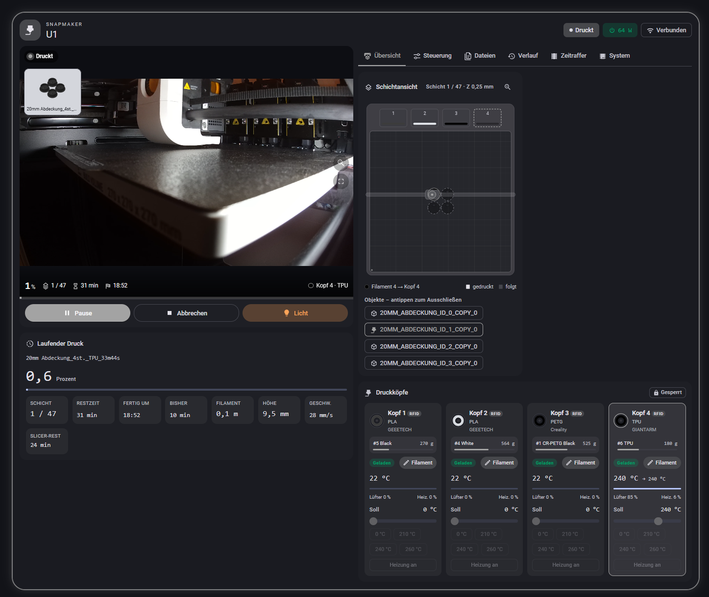

## What it does

**Printing**
- Start prints with the filament mapping of Snapmaker Orca, including a cost estimate, the file's slicer settings and a warning when a spool will not last
- Queue, pause at a layer, reprint from the history, exclude objects during a print
- Layer view in the colours of the loaded spools with sliders for layer and progress, G-code preview of any file before printing, remaining time calibrated on the real print

**Printer**
- All values live from the printer: temperatures, fans, light, axes, MCU and CPU load
- Full control: pause, cancel, emergency stop, homing, temperatures, fans, speed, flow
- Temperature chart for heads, bed, chamber, stepper drivers and CPU
- Bed mesh heatmap, G-code console, pick and park heads, top cover mode and chamber heater

**Camera**
- WebRTC at home, RTSP through Home Assistant when away (Nabu Casa), MJPEG or still images as fallback, including the stock firmware camera
- Zoom, fullscreen, second (USB) camera, timelapse player with backup to the media folder

**Filament and Spoolman**
- Material, vendor and colour per head from the firmware and RFID tags, editable for spools without a tag
- [Spoolman](https://github.com/Donkie/Spoolman): own tab with the stock, spool per head, new spools with suggestions from Spoolman's catalogue, usage booked per head, prices from Spoolman, SpoolLink support

**Around the printer**
- Phone notifications with camera image and buttons, live progress notification on Android
- Power switch with clean shutdown, auto-on and auto-off, energy and cost per print
- History, statistics per material, maintenance planner, firmware check, self test, configuration backup, voice commands via Assist
- Settings right in the card; the card follows your theme and language (English, German, Spanish, French, Italian, Dutch, Portuguese or Turkish)

It works the same locally, over VPN and through Nabu Casa.

## Screenshots

The screenshots show the German interface; the card and the integration follow the language of Home Assistant.

| Control: bed mesh, flow, temperatures, console | History and statistics |
|---|---|
| 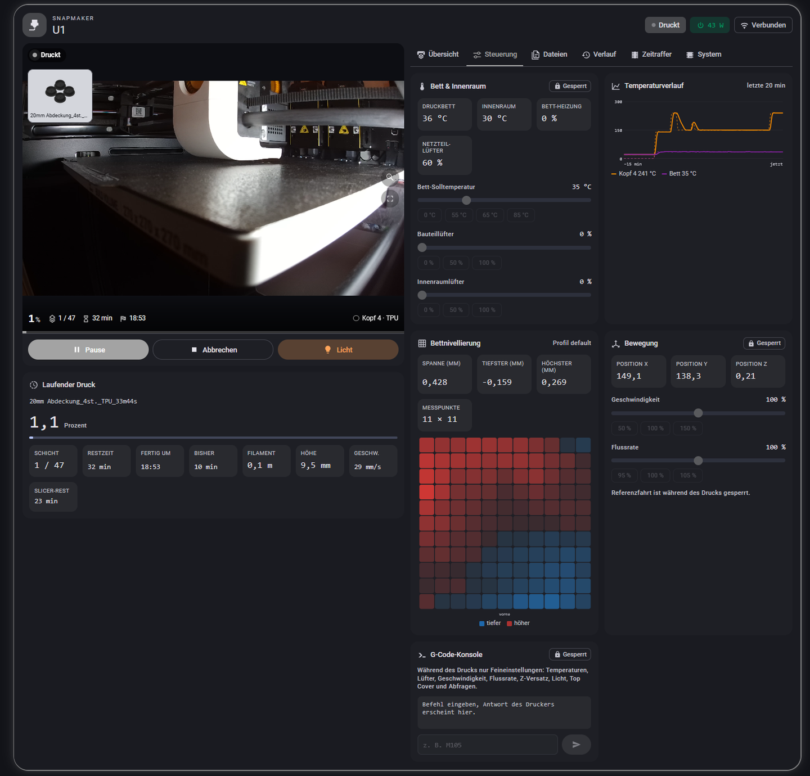 | 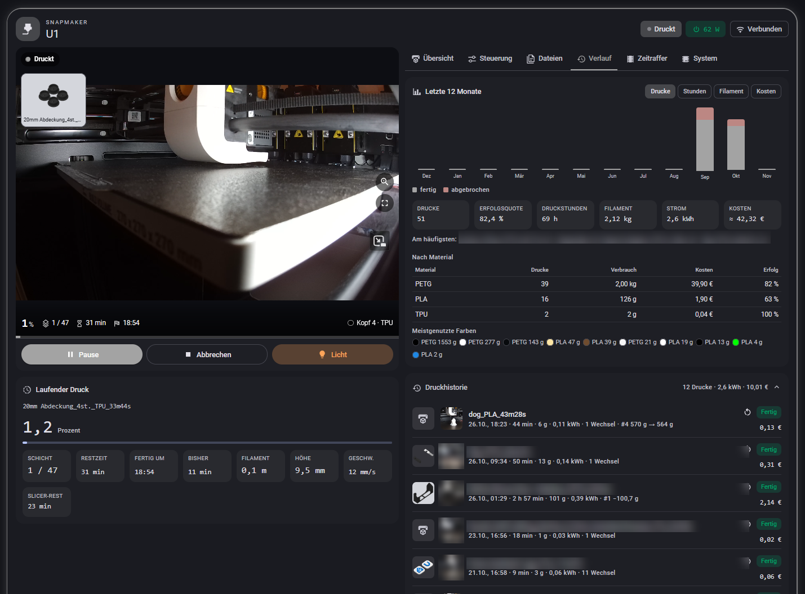 |
| **Files with thumbnails** | **System, maintenance and diagnostics** |
| 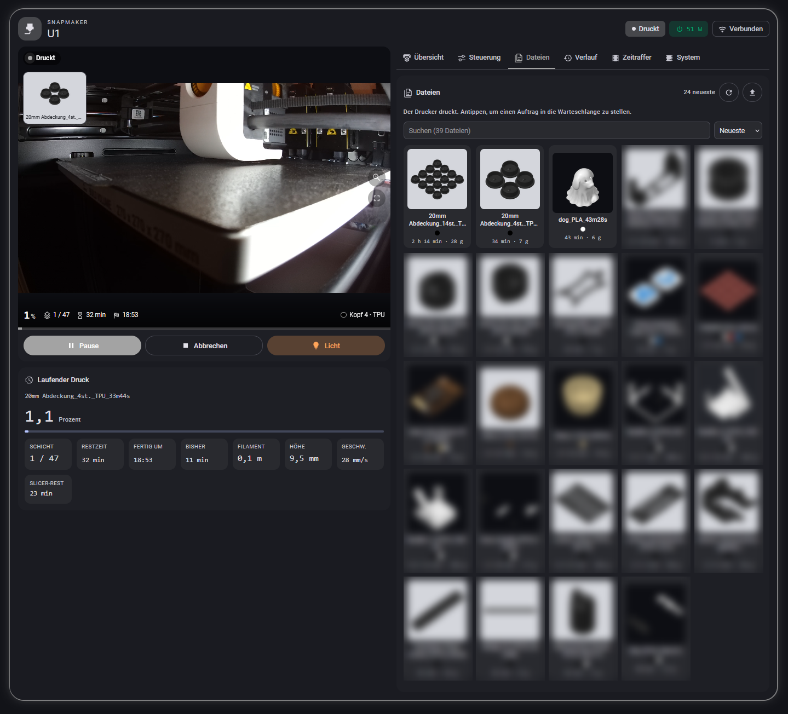 | 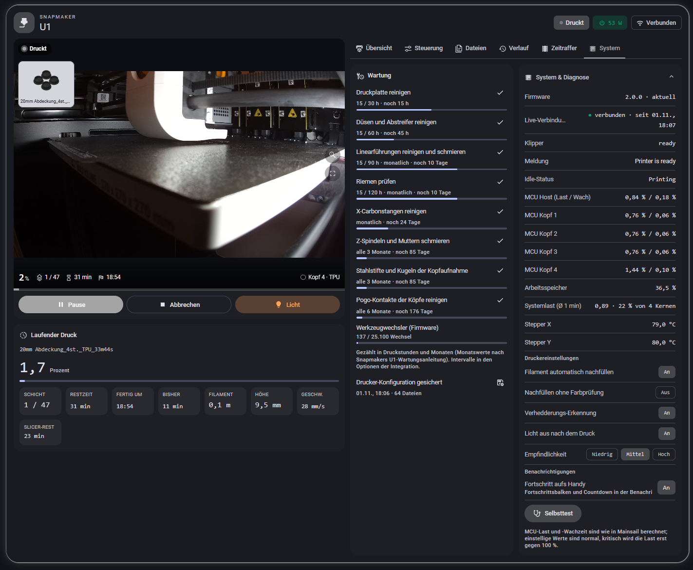 |
| **Exclude an object during the print** | **Timelapse player** |
| 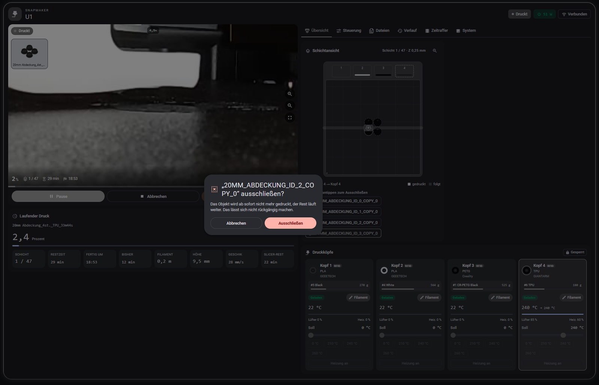 | 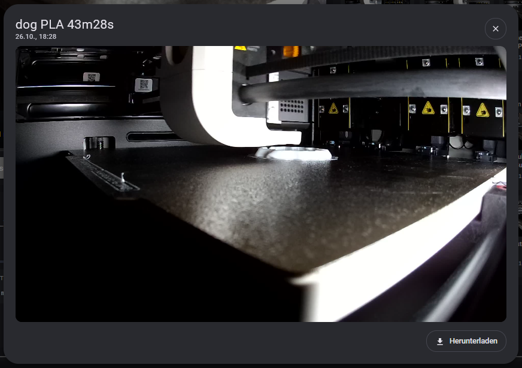 |
| **Print start with filament mapping** | **Self test** |
| 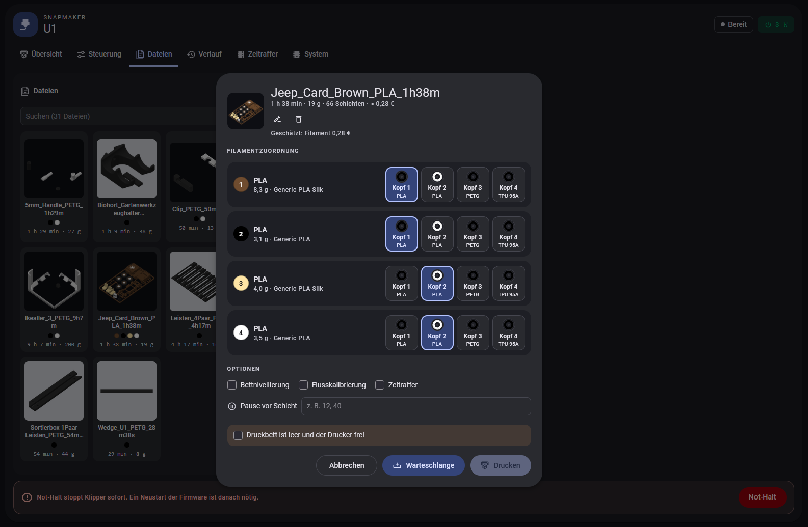 | 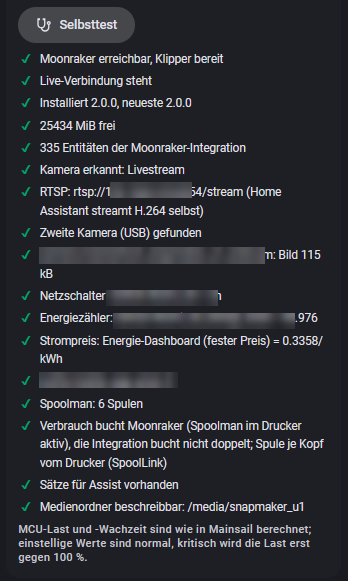 |

<details>
<summary>Settings in the card, notifications, phone</summary>

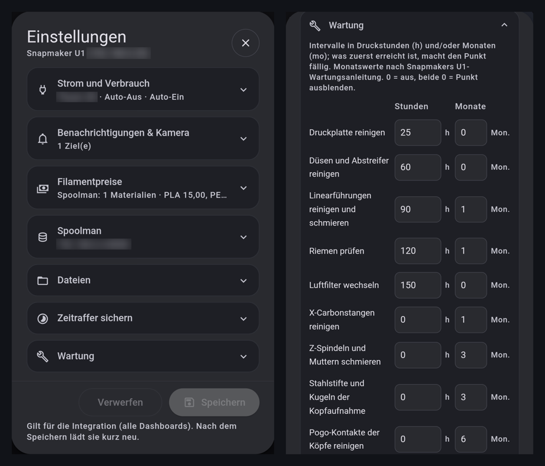

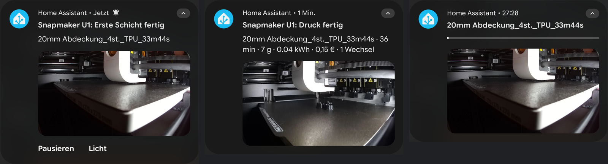

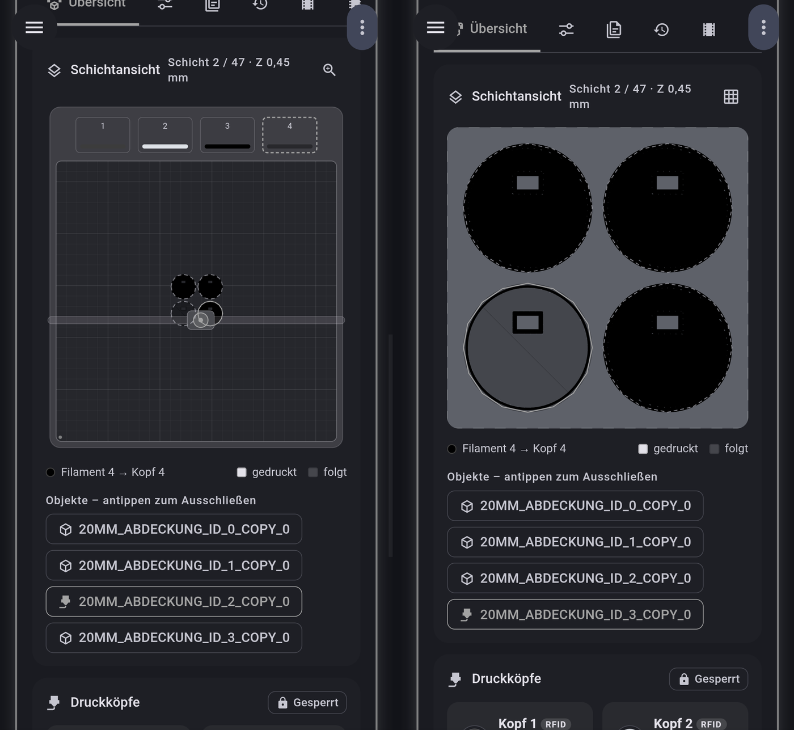

</details>

## Requirements

- Home Assistant 2025.3 or newer, [HACS](https://hacs.xyz) recommended
- Snapmaker U1 on the network with a fixed IP address
- Firmware: Snapmaker stock, Extended Firmware (paxx12) or stock with Bespok3d
- Optional: Companion app (notifications), a smart plug and energy meter (power, energy, cost), [Spoolman](https://github.com/Donkie/Spoolman)

The integration talks to Moonraker on the printer (port 80); the stock firmware needs no API key.

## Installation

**1. Download**

[](https://my.home-assistant.io/redirect/hacs_repository/?owner=Ironoxx&repository=ha-snapmaker-u1-card&category=integration)

Search for **Snapmaker U1 Card** in HACS (Home Assistant 2026.11 and newer: *Settings → Marketplace*), download it and restart Home Assistant.

<details>
<summary>Other ways: custom repository, manual</summary>

- **Custom repository** (if the search does not find it yet): HACS → ⋮ → *Custom repositories* → `https://github.com/Ironoxx/ha-snapmaker-u1-card`, type *Integration*.
- **Without HACS:** copy `custom_components/snapmaker_u1_card` from the [latest release](https://github.com/Ironoxx/ha-snapmaker-u1-card/releases/latest) to `/config/custom_components/` and restart.

</details>

**2. Set up**

[](https://my.home-assistant.io/redirect/config_flow_start/?domain=snapmaker_u1_card)

*Settings → Devices & services → Add integration → Snapmaker U1 Card*, enter the printer's IP address. The second step has all settings; everything is optional and can be changed later.

**3. Add the card**

*Add card → Snapmaker U1* (or *Snapmaker U1 Mini*), or in YAML:

```yaml
type: custom:snapmaker-u1-card
```

It works best in a *Panel* view or a full-width *Sections* view. No resource needed, the integration registers the card itself.

**4. Self test**

In the card under *System → Self test*: checks printer, camera, power entities and notifications.

**Updating:** update in HACS and restart Home Assistant. Settings, history and spool assignments are kept. Do not delete and re-add the integration, that starts a new entry without your history.

**Moonraker integration:** not needed since 2.0, and best left out. It queries the printer on top of this integration, which only adds load on the printer for values the card already has. If you have it installed, disable or remove it; it is not required, and the card only falls back to it when its own values are missing.

## Documentation

- [Configuration](docs/configuration.md): integration settings, settings in the card, card options, mini card
- [Features in detail](docs/features.md): filament mapping, camera, notifications, remaining time, Spoolman, energy and cost, maintenance and more
- [Entities and services](docs/reference.md): all entities, services and events for your own automations
- [Troubleshooting](docs/troubleshooting.md)
- [Architecture](docs/ARCHITECTURE.md) and [contributing](CONTRIBUTING.md) for developers

## Feedback and support

Bugs and ideas are welcome as an [issue](https://github.com/Ironoxx/ha-snapmaker-u1-card/issues), ideally with the diagnostics file (*Devices & services → Snapmaker U1 Card → ⋮ → Download diagnostics*) and your firmware version.

The integration is free. A star on GitHub helps, and if you like, buy me a coffee:

[](https://ko-fi.com/ironoxx)

## License

MIT, see [LICENSE](LICENSE). No warranty, use at your own risk. Not an official Snapmaker product and not affiliated with Snapmaker; "Snapmaker" and "U1" are trademarks of their owners.
